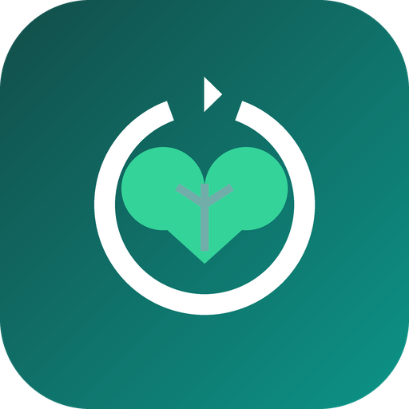

# WorkWell 360

**Wellness. Performance. Purpose.**

A complete **workplace mental-wellness ecosystem** — not just a
counselling-booking app. Built as an installable, offline-capable **PWA**, ready to wrap for the
Google Play Store.

Powered by Counsellor Priscilla Maina.



---

## The 11 pillars
| | Pillar | What it does |
|---|--------|--------------|
| 🧠 | Mental Health | Everyday emotional wellbeing + counselling |
| 😰 | Stress Management | Stress dashboard, breathing, time/priority tool, boundaries, workload script, self-care checklist |
| 🔥 | Burnout Recovery | Self-check, energy/sleep tracker, rest planner, recovery plan, return-to-work |
| 😡 | Anger Management | Self-assessment, diary, triggers, STOP–PAUSE–REFLECT–RESPOND, assertive-communication builder |
| 🤝 | Conflict Resolution | Style self-map, hard-conversation script builder, incident log, de-escalation, escalation ladder |
| 💼 | Workplace Counselling | Verified provider directory + in-app session requests + anonymous reporting |
| 👨‍👩‍👧 | Family & Relationships | Parenting, caregiving, work–life spillover, family pathways |
| 💍 | Marriage & Partnership | Weekly six-area check-in with trend, repair script, connection habits, money talk, pre-marital checklist |
| 🌿 | Substance Use & Recovery | Honest use check, craving log, day counter & milestones, trigger map, personal urge plan, Kenyan helplines |
| 🩺 | Chronic Illness | Load check, symptom/flare log, medication tracker, energy pacing, appointment prep, work-disclosure script |
| 🕊️ | Loss & Grief | Support check, understanding grief, remembrance exercise, grief journal, bereavement counselling |

Plus: **"What do you need today?"** router (11 pathways), **Self-care store** (journals + courses), breathing &
grounding tools, corporate packages, and a crisis-support screen.

## Privacy by design
All personal data — check-ins, journals, assessments, craving logs, conflict entries, couple
check-ins and symptom/medication logs — lives **on-device** in `localStorage`.
It is never shared with your employer — no individual entries or counselling. Users can export or
erase everything from Settings. The substance-use, marriage and chronic-illness centres are
self-help tools, not clinical care, and each one carries a route to urgent support.

## Run locally
```bash
python -m http.server 8787
# open http://127.0.0.1:8787/index.html
```
It's a static site — any static server works. Requires HTTPS (or localhost) for the service worker.

## Project structure
```
index.html            App shell + bottom nav
manifest.webmanifest  PWA manifest (icons, shortcuts, screenshots)
sw.js                 Offline-first service worker
privacy.html          Privacy policy (required for Play listing)
css/app.css           Design system (light/dark, mobile-first)
js/
  app.js              Router + bootstrap
  store.js            Local-first persistence
  ui.js               Shared components/helpers
  data.js             All content (pillars, providers, courses, packages…)
  views/*.js          One module per area
icons/                App icons (SVG master + PNG 192/512 + maskable)
.well-known/          assetlinks.json for TWA verification
playstore/            Bubblewrap manifest + publishing guide + listing copy
screenshots/          Store screenshots
```

## Publish to Google Play
See **[playstore/PLAYSTORE.md](playstore/PLAYSTORE.md)** — host on HTTPS (GitHub Pages works),
wrap with Bubblewrap (TWA), link via Digital Asset Links, upload the `.aab`.

## Tech
Vanilla JS (ES modules), no build step, no dependencies. Themable, accessible, responsive.

## Roadmap (backend-ready hooks)
- Accounts + cloud sync (currently local-only)
- M-Pesa / card payments for store & counselling commission — see **[docs/MPESA_INTEGRATION.md](docs/MPESA_INTEGRATION.md)**
- Real provider onboarding & verification
- Push reminders (via Capacitor wrapper)
